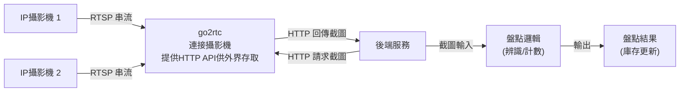
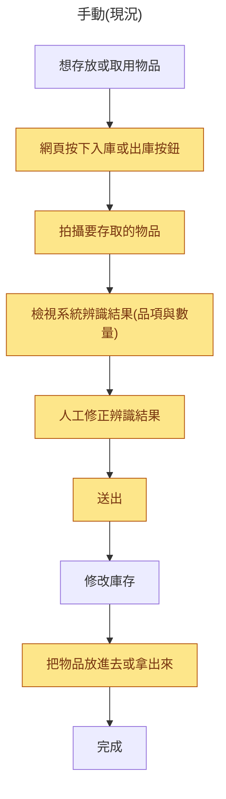
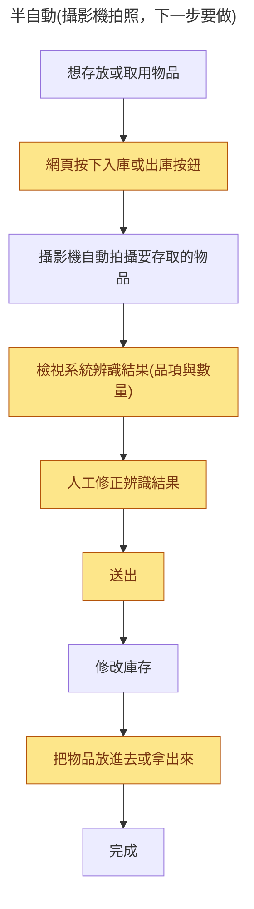
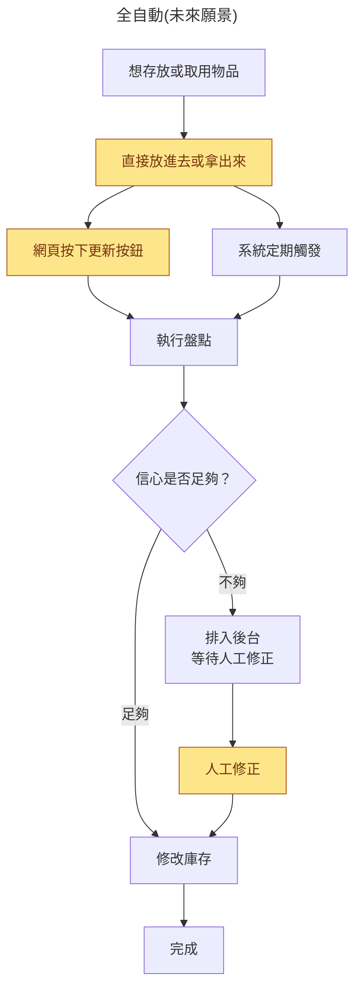

# 這周進度
1. 出庫
2. 盤點
3. 庫存歷史紀錄

基本上一開始的功能都滿足了

# 接下來進度
1. 攝影機自動盤點：go2rtc連結區網內ip攝影機，後端透過http跟go2tc要攝影機截圖，截圖跑盤點邏輯

2. 辨識優化：
	1. 減少時間、提升精準度(不動模型，單純套用常見算法)、
	2. 可追蹤模型辨識結果和人工修正結果，匯出訓練資料集

# 可討論的自動化/新功能
1. 省略人工拍照出入庫：直接放入拿出物品，接著按按鈕，或週期觸發重新計數，算差額決定出入庫了多少

下一步先做「半自動」，不是一次跳到完整自動化：維持現在的人工審核流程(辨識結果還是要人看過、修正、送出才會真的改庫存)，只把「拍照」這一步換成按按鈕叫攝影機拍，不用自己拿手機對著物品拍。信心門檻判斷、自動改庫存、不足信心排入後台給人工修正，這些留在「全自動」階段，等半自動的流程驗證過、攝影機實際拍出來的照片辨識品質確認可用之後再做。

原本：每次存取都要經過四到五個步驟,其中「拍攝」還要自己拿手機對準物品。半自動後：省掉手動拿手機拍攝這一步,改成按鈕觸發攝影機拍,其他人工審核步驟不變。全自動後：最好的情況下使用者只需要一個步驟「放進去或拿出來」。

2. 未知物件提示新增

辨識到資料庫中沒有的物件時，提示「這是新物品嗎？」，選擇是可以直接新增。

3. 攝影機健康檢查

偵測到攝影機全黑、模糊、角度被移動、鏡頭被擋住等情況發出提醒。

4. 消耗速度推估

用出庫歷史算出平均消耗速度，推估「大約幾天後用完」提前提醒。

5. 產生補貨清單

把所有低於門檻或快用完的物品整理成清單輸出。

# 採購清單

## rpi5
又漲價，而且普遍沒貨。

| 價格 | 備註 | 連結 |
| --- | --- | --- |
| 5100(4700+400) | 有殼，只能郵寄 | [連結](https://www.oursteam.com.tw/view-product.php?id=982) |
| 7400 | 沒殼，2027/3才有貨 | [連結](https://twcn.rs-online.com/web/p/raspberry-pi/0219253?cm_mmc=TW-PLA-DS3A-_-google-_-PLA_TW_CN_Pmax_Top+Supersections_20251110-_--_-&matchtype=&&campaignid=23259001560&gclsrc=aw.ds&gad_source=1&gad_campaignid=23264857643&gbraid=0AAAAADkeWNOUkNQ6_ZDnLgs0OOqWOvIov&gclid=CjwKCAjw56zWBhB0EiwAdPOQOdO9f10khPG-YRNauB0v6toYbAHvSLeIG6DkYpLehIzt7mHdNoFz8hoCHo4QAvD_BwE) |
| 4100 | 沒殼，ebay(不好報統編) | [連結](https://www.ebay.com/itm/186268654816?chn=ps&_trkparms=ispr%3D1&amdata=enc%3A1W9Smfr1DQcyvycZbtQZhzA20&norover=1&mkevt=1&mkrid=711-167022-057772-8&mkcid=2&itemid=186268654816&targetid=325425753764&device=c&mktype=pla&googleloc=9195719&poi=&campaignid=20686205678&mkgroupid=158704283430&rlsatarget=pla-325425753764&abcId=&merchantid=552645245&gad_source=1&gad_campaignid=20686205678&gbraid=0AAAAAD_QDh-yXVBE3gYNSgaiGyJFaajTn&gclid=CjwKCAjw56zWBhB0EiwAdPOQOTtmO6_HU3Yqh-YR3AkPQoT5Jy5pAmUQUKQNEJ_9DjC9zmJyvL9M-RoCnEIQAvD_BwE) |

## ip攝影機
可能要2台，才能至少展現出多儲存區的概念。

| 價格 | 備註 | 連結 |
| --- | --- | --- |
| 1000 | 要用go2rtc自己host http api(有docker image) | [連結](https://24h.pchome.com.tw/prod/DCBE1X-A900B9VCN?utm_source=google&utm_medium=cpc&utm_campaign=awo_mkt_conversion_PMprofit_all_all_gg_pla_mix_mktcampaign&gad_source=1&gad_campaignid=23915533654&gclid=CjwKCAjw56zWBhB0EiwAdPOQOR87w_lBr260VX8Aj-kxHa1KapHFUvvpFQLhNRpNKEQaeMZMUclNmBoCUVYQAvD_BwE) |
| 3000 | 有http api | [連結](https://24h.pchome.com.tw/prod/DCAS65-A900IHERF) |

# 其他
https://docs.google.com/document/d/1ATFHXC9sXx-qu5Quwg_76Vuy4RzYnVhjTCpWqSU5Mms/edit?tab=t.0