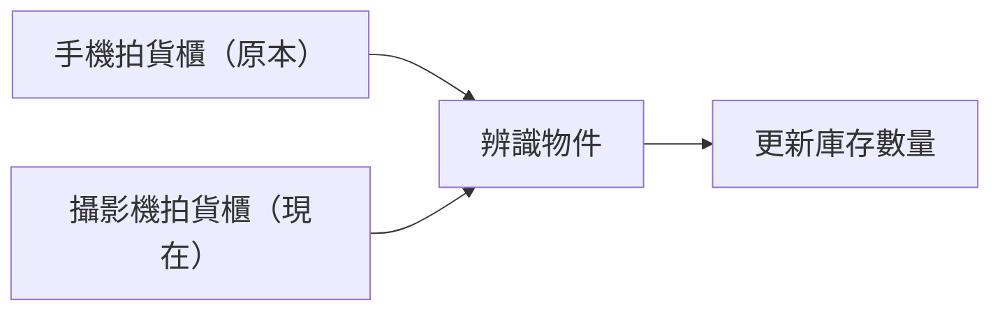
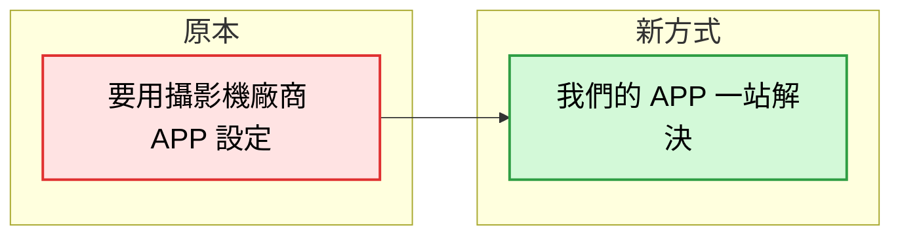
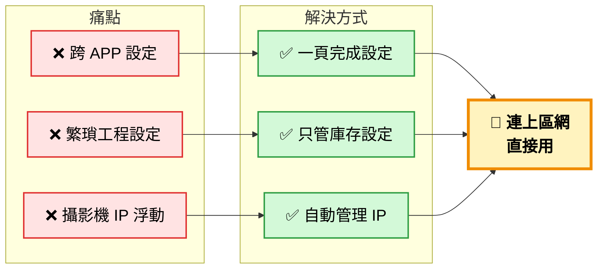
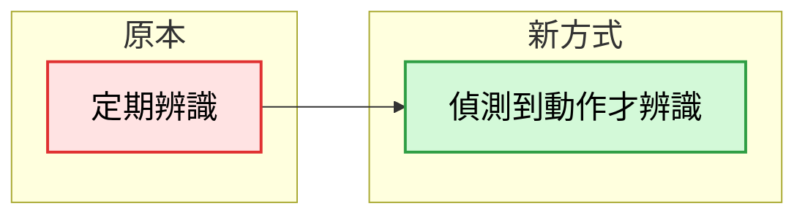
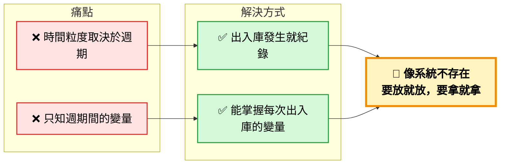

# 2026-10-20 進度報告

## 這周進度

### 1. 導入實體攝影機，接入原本的盤點流程

#### 概要

- 攝影機環境建置
- 攝影機來源抽象化介面，實作兩種來源：靜態測試圖片、真的攝影機
- 實際跑通盤點資料流：後端真的攝影機拿到圖片，辨識物件，完成盤點

---

## 可改善的

### 1. 自動化攝影機設定流程

#### 要做什麼

#### 為什麼

#### 原本流程
2. 廠商 APP：設定攝影機帳號密碼
3. 廠商 APP：看攝影機 IP
4. 我們的 APP（後台介面）：手動設定名字、IP、帳號密碼、關聯物品

#### 問題
太綁設備(IP攝影機甚至廠牌?，比如GPIO攝影機同軸攝影機就用不瞭)，真的要做要考慮非設備相依

---

### 2. 動作觸發出入庫

#### 要做什麼

#### 為什麼

# 要做的事
1. 錄製使用流程影片

